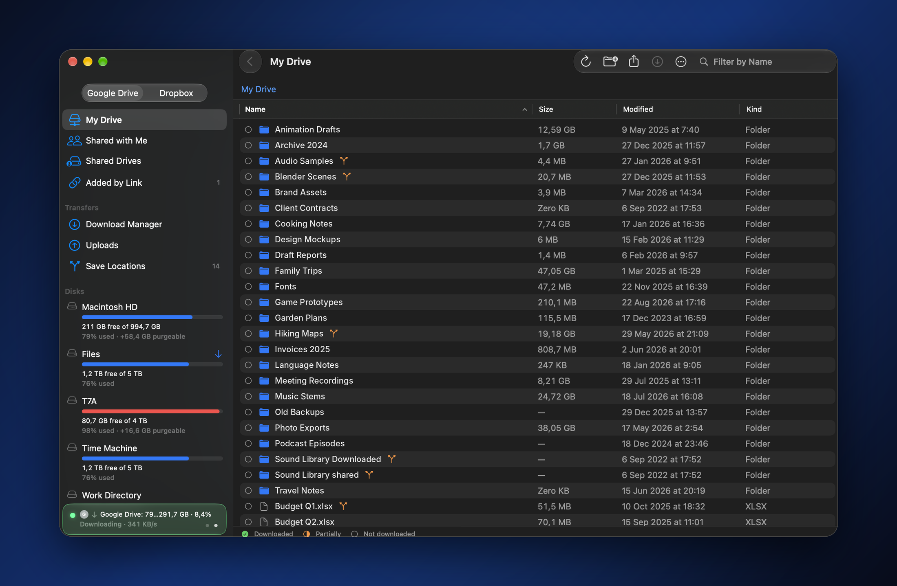

<p align="center"><b>English</b> · <a href="README.ru.md">Русский</a> · <a href="README.uk.md">Українська</a> · <a href="README.de.md">Deutsch</a> · <a href="README.es.md">Español</a> · <a href="README.hi.md">हिन्दी</a> · <a href="README.el.md">Ελληνικά</a></p>

# NaviDrive

<p align="center"></p>

<p align="center">A native macOS client for Google Drive and Dropbox, focused on fast, resumable downloads and uploads of large files and folders.</p>

A native macOS client for Google Drive and Dropbox, focused on fast, resumable downloads and uploads of large files and folders.

## Features

- Browse Google Drive (My Drive, Shared with me) and Dropbox; several clouds connected at once.
- Download manager: parallel chunked downloads with adaptive concurrency, pause and resume, progress that survives restarts, network loss and disconnected disks.
- Checksum verification after download (MD5 for Google Drive, content hash for Dropbox).
- Download to a default folder, a custom folder or an external disk; permanent save locations per cloud folder; free-space checks before downloading.
- Shows which cloud files are already downloaded to this Mac.
- Upload manager with resumable uploads; "Upload to NaviDrive" in the Finder Services menu.
- Add files and folders by link (Google Drive link or ID, Dropbox shared link).
- Folder size calculation, new folder, move, move to Trash.
- Tracks Google Drive daily transfer limits and resumes transfers automatically when they reset.
- Menu bar status, optional "keep the Mac awake during transfers", "Quit When Done", hold ⌘Q to quit.
- In-app updates from GitHub Releases: weekly or manual check; the download is verified (SHA-256, signing certificate, version) before installing.
- English and Russian interface.

## Requirements

- macOS 15 or later.
- Apple silicon or Intel: release DMGs built by `Scripts/release.sh` are universal (`arm64` + `x86_64`); a plain local build is `arm64` only.
- To build: Xcode 16 or later and [XcodeGen](https://github.com/yonaskolb/XcodeGen).

## Installation

Download `NaviDrive-X.Y.Z.dmg` from [GitHub Releases](https://github.com/dotsentik/NaviDrive/releases), open it and drag NaviDrive to Applications. See [First launch](#first-launch) before opening it for the first time.

## First launch

Release builds are signed with the project's own certificate and are not notarized by Apple, so on another Mac Gatekeeper blocks the first launch from the DMG.

1. Drag NaviDrive to Applications, then right-click it → Open → Open.
2. If that does not help, run in Terminal:
   `xattr -dr com.apple.quarantine /Applications/NaviDrive.app`
3. If the DMG came through a sandboxed messenger (for example, Telegram) and macOS says "File created by an AppSandbox", run:
   `sudo xattr -cr /Applications/NaviDrive.app`

Download the DMG from GitHub Releases in a browser or send it over AirDrop to avoid step 3.

These steps are needed only once. Updates installed from inside the app (NaviDrive → Check for Updates…) do not need them.

## Building from source

```sh
cp Config/Secrets.example.xcconfig Config/Secrets.xcconfig   # then fill in the values, see below
xcodegen generate
xcodebuild -project NaviDrive.xcodeproj -scheme NaviDrive -configuration Release \
  -derivedDataPath ./DerivedData -quiet build
Scripts/make_dmg.sh   # ~/Desktop/NaviDrive-<version>.dmg
```

Releases are made with `Scripts/release.sh X.Y.Z` from a clean `main`: it builds a universal app, checks the signing certificate against `Config/signing-fingerprint.txt`, creates `NaviDrive-X.Y.Z.dmg` and `NaviDrive-X.Y.Z.dmg.sha256`, takes the notes from `CHANGELOG.md` and publishes them with `gh`. `Scripts/release.sh --dry-run X.Y.Z` builds and checks the files without publishing.

`NaviDrive.xcodeproj` is generated from `project.yml`; change build settings there, not in the Xcode project.

Release builds are signed with the "NaviDrive Signing" certificate. Without it in your keychain, change `CODE_SIGN_IDENTITY` in `project.yml` for a local build. Copies signed with another certificate cannot update copies signed with the original one; see [docs/SIGNING.md](docs/SIGNING.md).

## OAuth configuration

Cloud credentials are not stored in the repository. `Config/NaviDrive.xcconfig` includes the untracked `Config/Secrets.xcconfig`; its values reach `Info.plist` as `$(GOOGLE_CLIENT_ID)`, `$(GOOGLE_CLIENT_SECRET)` and `$(DROPBOX_APP_KEY)`.

- **Google Drive**: create an OAuth client of type "Desktop app" in Google Cloud Console with the Drive API enabled, and put its Client ID and Client Secret into `Config/Secrets.xcconfig`. Without them the build has no built-in Google sign-in, and users enter their own Client ID and Client Secret in Settings (stored in the Keychain).
- **Dropbox**: create an app at dropbox.com/developers/apps, add the redirect URI `http://127.0.0.1:53682/callback`, and put its App key into `DROPBOX_APP_KEY`. Without it Dropbox sign-in is unavailable.

## Security and privacy

- OAuth tokens and user-entered credentials are stored in the macOS Keychain.
- The app talks only to Google (accounts.google.com, oauth2.googleapis.com, www.googleapis.com) and Dropbox (dropbox.com, api.dropboxapi.com, content.dropboxapi.com), plus GitHub (api.github.com and its release download hosts) when checking for updates. There is no analytics or telemetry.
- Sign-in uses a local loopback server on 127.0.0.1 to receive the OAuth response.
- The queue, history and folder sizes are kept in a local SQLite database in `~/Library/Application Support/NaviDrive`.

## Repository layout

```
Sources/
  API/        Google Drive and Dropbox API clients and providers
  App/        app entry point, AppModel and its extensions
  Auth/       OAuth, loopback server, token management
  Cloud/      cloud-agnostic item and provider types
  Download/   download scheduler, workers, chunk writing, verification
  Upload/     upload planner, scheduler, workers
  Update/     update check, verification and installation
  Storage/    SQLite database, settings, Keychain
  Models/     shared models and formatters
  Views/      SwiftUI views
Resources/    asset catalog, localization (en, ru), design sources
Support/      Info.plist
Config/       xcconfig files, signing fingerprint
Scripts/      release, DMG and icon tooling
Tests/        unit tests (update logic)
docs/         signing and maintenance documentation
project.yml   XcodeGen project definition
```

## License

MIT, see the [LICENSE](LICENSE) file.
